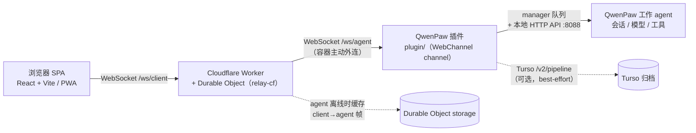

# QwenPaw WebChannel · 自建 Web 前端通道

[](https://github.com/yun-muse/qwenpaw-webchannel/actions/workflows/ci.yml)

让运行在容器里的 QwenPaw agent 拥有一个可安装到手机的 Web 前端：浏览器只连 relay，插件从容器**主动外连**，不需要开放任何入站端口，也不需要改动 QwenPaw 本体。

**在线实例**：[SPA](https://qwenpaw-webchannel-spa.pages.dev) · [Relay 健康检查](https://qwenpaw-webchannel-relay.yxliwangsheng.workers.dev/health)

## 功能（以 M15 代码为准）

- **流式对话**：`start` / `evt` / `end` / `msg` 逐 delta 推送，思考和正文分成两个 `stream_type`，前端不会把推理内容混进回答（`plugin/channel.py`、`protocol/frames.md` §2.3）。
- **多会话 / 多标签同步**：每个 chat 独立 `seq` 和 400 帧环形缓冲，重连用 `resume` 补发、缺口用 `resync` 重载；relay 把 agent 的帧广播给所有标签页。重连时只自动 resume 当前会话，其他会话在切换过去时重新拉 `hist`。会话列表与删除走服务端（`chats` / `del_chat`），重命名由 `rename_chat` 回执后保存在浏览器本地（`webchannel.chatNames`）。
- **按 agent 切换模型**：`models` / `set_model` 复用 QwenPaw 的模型选择逻辑，只把 `{provider, model, active}` 发到浏览器，凭据字段不出插件（`plugin/util.py::model_items`）。
- **`/` 命令与 `@skill`**：输入框上方的命令面板（模型、技能、新会话、停止、提示词、重命名、删除、清屏、主题、帮助）和 `@` 技能挂载；技能列表优先来自 `/api/skills`（失败时回退到技能注册表 / `agent.json`），也可直接在 SPA 里编辑 `SOUL.md` / `AGENTS.md` / `PROFILE.md` / `MEMORY.md`。
- **推理强度选择**：`default | low | medium | high | max`，`default` 即 QwenPaw 的 `inherit`；budget 模型会换算成 `budget_tokens`，effort 模型只发它声明过的档位，状态以服务端 `chat.meta` 为准。
- **PWA 强制刷新**：`version.json` + 构建 ID 轮询，发现新版本后更新 Service Worker、清空 Cache Storage 并只自动刷新一次；自动刷新不生效时退回手动横幅（`spa/src/version.ts`）。
- **30 天免登录**：relay 签发 30 天有效的客户端 token，SPA 存在 localStorage 并本地预检过期时间；连续 3 次握手未打开才回到登录页（`relay-cf/src/index.ts`、`spa/src/relay.ts`）。
- **每轮用量回执 + 上下文仪表**：`hist.messages[].turn` 和 `usage.last_turn` 给每条回答挂上本轮 token；输入框上方显示上下文占用（≈ 估算），桌面端同时显示会话累计 `↑ ↓`。
- **Markdown 导出**：`export` → `export_begin` / `export_chunk` / `export_end`，分块传输、sha256 校验，上限 10 MB。
- **Turso 归档全文搜索**：插件把对话 best-effort 写入 Turso，`search` 在 `messages` / `chats` 上做参数化 `LIKE`，只回 snippet 和命中位置。
- **心跳自愈**：`hb` / `hb_ack` 端到端探测（15 s 一次、10 s 未回、连续 2 次失败重连），配合连接阶段监管和退避重连；只有 close 4000、`E_AUTH`、HTTP 401/403 或显式 `stop()` 才终止。
- **10 MB 分块附件与历史回看**：`file_begin` / `file_chunk` / `file_end`，96 KB 一片、sha256 校验、10 分钟暂存，成功后用 `{"ref": id}` 引用；`hist.messages[].files` 带名称/类型/大小（按 URL 去重、纯附件轮次保留），图片以 `FileContent` + `ImageContent` 双 part 交给多模态模型，历史里的缩略图与下载走 `att_get` → `att_begin` / `att_chunk` / `att_end`（opaque ref、10 MB 上限、media_dir 路径守卫）。

## 架构



- 浏览器永远不直接连容器；relay 只做配对和逐字转发，不解析业务帧，也不存储消息内容（唯一的持久化是 agent 离线时的 client→agent 缓冲）。
- 一个容器对应一个 agent socket；`relay-cf` 的单个 Durable Object 持有该租户的全部 socket。
- 本地开发可以用 `relay-node`（`ws` 一个依赖）替代 Cloudflare，SPA 和插件代码不用改。

## 仓库结构

| 目录 | 内容 |
|---|---|
| [`plugin/`](plugin/README.md) | QwenPaw 通道插件（Python）：relay 客户端、帧、流式、附件、模型、推理强度、用量、导出、搜索、Turso 归档 |
| [`relay-cf/`](relay-cf/README.md) | 生产 relay：Cloudflare Worker + Durable Object（TypeScript） |
| [`relay-node/`](relay-node/README.md) | 本地开发 relay（Node.js，仅依赖 `ws`），协议行为与 `relay-cf` 对齐；不做客户端鉴权和限流 |
| [`spa/`](spa/README.md) | 浏览器前端：React 18 + TypeScript + Vite 5，含 PWA 与移动端布局 |
| [`protocol/`](protocol/frames.md) | 帧协议：信封 v1，累加修订到 v8 |
| [`docs/`](docs/README.md) | 设计文档、部署记录与各里程碑报告 |
| [`mock/`](mock/README.md) | 假 agent，用于在没有 QwenPaw 的情况下跑通本地链路 |
| `tools/` | `package_plugin.sh`（可复现 ZIP）、`turso_history.py`（归档回读）、`soak_probe.mjs`、`oc_prompt.py` |
| `tests/` | Playwright / WebSocket 端到端脚本（`e2e_*.mjs`、`mobile_e2e.mjs`） |
| `tasks/` | 各里程碑的任务书（开发过程资料，不是产品文档） |

## 快速开始

每个组件都有独立的 README；最短的本地链路是「relay-node → mock agent → SPA」：

| 组件 | 命令 | 文档 |
|---|---|---|
| 本地 relay | `cd relay-node && npm install && npm start` | [`relay-node/README.md`](relay-node/README.md) |
| 假 agent（可选） | `cd mock && npm install && npm start` | [`mock/README.md`](mock/README.md) |
| SPA | `cd spa && npm install && npm run dev` → http://localhost:5173 | [`spa/README.md`](spa/README.md) |
| QwenPaw 插件 | `bash tools/package_plugin.sh` → 安装 `dist/webchannel.zip` | [`plugin/README.md`](plugin/README.md) |
| relay-cf（本地 wrangler） | `cd relay-cf && npm install && npm run dev` → http://localhost:8788 | [`relay-cf/README.md`](relay-cf/README.md) |

本地默认值：relay 在 `127.0.0.1:8787`，SPA 在 `5173`，插件连 `ws://127.0.0.1:8787/ws/agent`；没有登录门，Turso 归档/搜索默认关闭。

## 部署概要

完整步骤与已验证的输出见 [`docs/m3-deploy-cf.md`](docs/m3-deploy-cf.md)，逐条清单见 [`docs/m3-plan.md`](docs/m3-plan.md)。

1. **Relay**：`cd relay-cf && npx wrangler deploy`。三个 Worker secret 只按名字设置：`AGENT_TOKEN`、`LOGIN_PASSWORD`、`LOGIN_SECRET`（`npx wrangler secret put <NAME>`）。首次部署会应用创建 `RelayDO` 的 `v1` migration（`relay-cf/wrangler.toml`）。部署后用 `GET /health` 确认 `ok:true`。
2. **SPA**：用 `VITE_RELAY_WS` / `VITE_RELAY_HTTP` 指向 relay 后 `npm run build`，再发到 Pages 项目 `qwenpaw-webchannel-spa`：
   ```bash
   cd spa
   VITE_RELAY_WS=wss://<relay-host>/ws/client \
   VITE_RELAY_HTTP=https://<relay-host> \
   npm run build
   npx wrangler pages deploy dist --project-name qwenpaw-webchannel-spa --branch main
   ```
   `--branch main` 不是可选项：不带它时第一次部署会继承本仓库的 git 分支而落到 preview，生产根路径返回 404（`docs/m3-deploy-cf.md`）。
3. **插件（hosted 容器）**：`bash tools/package_plugin.sh` 生成 `dist/webchannel.zip`（`plugin.json` 在 ZIP 根目录），把它发布到 Pages 项目 `qwenpaw-plugin-dist`，即 <https://qwenpaw-plugin-dist.pages.dev/webchannel.zip>；上传后回下载一次比对 MD5，避免装到旧包。已验证的安装路径（最近一次是 M15）：
   1. 在 QwenPaw 控制台的 **Web Terminal** 里 `curl` 下载该 ZIP，解压到容器内的暂存目录；
   2. 控制台 → Plugins → 先 **Uninstall** 旧插件，再打开 **Install**，在 **"or from URL"** 字段里填**本地路径**（该字段接受容器内的本地目录），指向暂存目录（目录根需有 `plugin.json`，解压出来即是）；
   3. 确认 Channels 页面出现 **Web** 卡片、字段无误后，做一次平台 **Restart**。

   装好后 `GET /api/plugins` 里 `webchannel` 应为 `"loaded": true`。**不要**把插件目录直接拷进 `PLUGINS_DIR`（`WORKING_DIR/plugins/webchannel`）再重启：这样会跳过按 agent 的通道注册，**Web** 卡片不会出现，通道会卡死且重启也救不回来——这不是可用的备用路径。详细步骤见 [`plugin/README.md`](plugin/README.md)。
4. **启用通道**：在目标 agent 的 **Web** 卡片填 `relay_url`（hosted 用 `wss://…/ws/agent`）和 `token`（值等于 Worker 的 `AGENT_TOKEN`，只填值，不要写进仓库）。
5. **Turso（可选）**：填 `turso_url` / `turso_token` 后，归档写入与全文搜索才启用；表结构由归档器在启动时 `CREATE TABLE IF NOT EXISTS` 自动创建（`plugin/turso_archive.py`）。
6. **升级顺序**：心跳协议变更时先部署 relay、再重装/重启插件。旧 relay 不会 ack `hb`，会让新插件反复重连（`docs/m7.3-report.md`）。

## 协议

[`protocol/frames.md`](protocol/frames.md)：一条 WebSocket 文本消息一个 JSON 对象，必填字符串 `t`，未知字段和未知 `t` 必须忽略。当前是**信封 v1 + 累加修订到 v8**：

| 版本 | 内容 |
|---|---|
| v1 | 基础帧、握手机制、`seq` / `resume` / `resync`、256 KB 上限 |
| v2 | 分块文件上传（10 MB） |
| v3 | 模型列表与切换、`hb` / `hb_ack` 端到端心跳 |
| v4 | 会话推理强度 |
| v5 / v8 | 会话用量与每轮回执 |
| v6 | Markdown 导出 |
| v7 | Turso 归档全文搜索 |

`models` / `model_changed` / `status` / `effort` / `usage` / `export_*` / `search_results` 是**控制帧**：没有 `seq`、不进环形缓冲、不在 `resume` 时重放。

## 诚实的边界

- **导出只是当前上下文视图**。Markdown 由 `GET /api/chats/{ChatSpec.id}` 的 `ChatHistory` 渲染（`plugin/channel.py::_handle_export`），不是从 Turso 或完整事件日志重建。后端若已压缩上下文，早期轮次以历史接口实际返回为准；附件只记录文件名等元信息，不含内容；单次导出上限 10 MB。文档头部的「导出口径」也写明了这一点（`plugin/util.py::EXPORT_BASIS`）。
- **搜索只覆盖已归档的内容**。归档是 best-effort：有界队列、失败重试后丢弃，所以“搜不到”不等于“没说过”。查询是 `messages JOIN chats` 上的参数化 `LIKE`（不是 FTS 索引），每页最多 50 条，只回 snippet；未归档的轮次不可见（`protocol/frames.md` §13.3）。
- **审批默认是自动放行的**。协议、插件和 SPA 都有审批卡片与 `req_id` 归属校验（A5），但 hosted 的 `work` agent 没有 `tool_guard` / `file_guard`，`approval_level` 是 `AUTO`，所以工具调用根本不会触发审批；真实审批往返至今没有在 hosted 环境观察过（`docs/m3-findings.md`）。
- **用量是估算**。`context_tokens` 取最近一轮的 `last_prompt_tokens` → 状态估算 → `prompt_tokens`（`basis=last_turn_prompt`），不是实时 tokenizer；没有可用记录的轮次没有 `turn`，SPA 显示为“无数据”而不是 0。
- **relay 是单租户的**。一个部署一个 `TENANT`（`wrangler.toml`），30 帧/秒的令牌桶由该租户的所有 socket 共享；relay 不持久化消息内容，agent 离线缓冲上限 500 帧 / 1 MB。

## 开发与测试

插件测试是纯 Python 断言脚本，不需要 pytest：

```bash
cd plugin
python3 tests/test_diff.py     # 以及 test_m2 / test_m5 / test_turso / test_m7 /
                               # test_m71 / test_m72 / test_m73 / test_m8 / test_m9 /
                               # test_m11 / test_m12 / test_m13 / test_m15
```

每个脚本结束打印 `ALL PASS`。仓库根目录的 `tests/e2e_*.mjs` 是 Playwright / WebSocket 端到端脚本，需要本地 QwenPaw、relay 和 Node 环境；具体入口见各文件头部注释。
